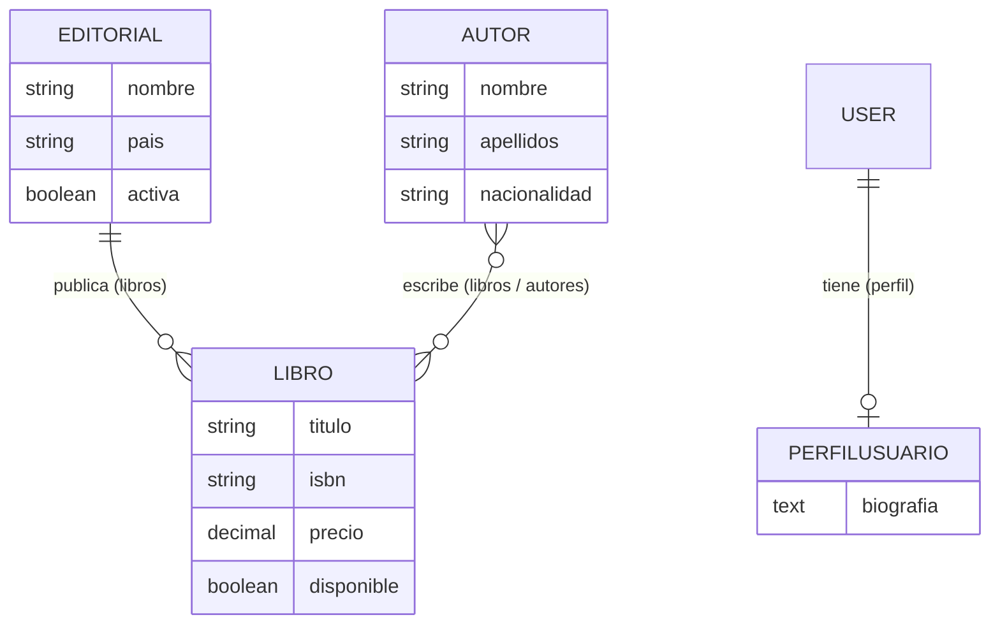

# Actividad de clase 6

## Actividad 6. Catálogo de modelos relacionados (proyecto `biblioteca`)

**Modelos y migraciones:**

1. Relacionar `Editorial` con `Libro` (1:N) con una `ForeignKey` en `Libro`: `on_delete=PROTECT`, `related_name="libros"` y `null=True, blank=True` para conservar los libros existentes.
2. Relacionar `Autor` con `Libro` (N:M) con un `ManyToManyField`.
3. Crear `PerfilUsuario` con un `OneToOneField` al modelo de usuario de Django (`on_delete=CASCADE`, `related_name="perfil"`).
4. Generar y aplicar las migraciones sin perder los libros existentes.

**Datos de prueba:** 2 editoriales, 4 autores y editorial y autores asignados a 5 libros; al menos 2 autores en un mismo libro; un usuario de prueba con su perfil, sin contraseñas reales.

**Consultas ORM (sin SQL directo):** libros de una editorial, libros de un autor, autores de un libro, libros por editorial con `annotate()`, intento de eliminar una editorial con libros (`PROTECT`), consultas con `related_name`, `select_related()` y `prefetch_related()`, `Prefetch` con solo los libros disponibles y comparación de las consultas SQL antes y después de optimizar.

**`on_delete`:** explicar qué ocurre con los libros al eliminar su editorial según cada opción y probar `PROTECT` y `SET_NULL` en una copia de la base de datos.

**Ampliación opcional (`through`):** modelo intermedio `Participacion` con la función de cada autor en un libro. No se incluye en esta entrega.

**Entrega:** `models.py`, migraciones, archivo con las consultas ORM y diagrama de relaciones. No se piden vistas ni formularios.

---

## Resolución

### Preparación

```bash
python manage.py migrate
python manage.py shell < cargar_libros.py
python manage.py shell < actividad6_datos.py
python manage.py shell < actividad6_consultas.py
```

`cargar_libros.py` crea los diez libros y sus autores; `actividad6_datos.py` añade las editoriales, las asigna a cinco libros, añade un segundo autor a uno de ellos y crea el usuario de prueba. Ambos se pueden repetir sin duplicar datos.

### Modelos y migraciones

Relaciones definidas en `catalogo/models.py`:

```python
class Libro(models.Model):
    ...
    editorial = models.ForeignKey('Editorial', on_delete=models.PROTECT, related_name='libros', null=True, blank=True)
    autores = models.ManyToManyField('Autor', related_name='libros', blank=True)


class PerfilUsuario(models.Model):
    usuario = models.OneToOneField(
        settings.AUTH_USER_MODEL,
        on_delete=models.CASCADE,
        related_name="perfil",
    )
    biografia = models.TextField(blank=True)
```

| Migración              | Contenido                                      |
| ---------------------- | ---------------------------------------------- |
| `0006_libro_editorial` | Añade `Libro.editorial` (1:N, `PROTECT`, nula) |
| `0007_libro_autores`   | Añade `Libro.autores` (N:M)                    |
| `0009_perfilusuario`   | Crea `PerfilUsuario` (1:1 con el usuario)      |

Como `editorial` admite nulos y `autores` admite vacío, las migraciones se aplican sin perder ningún libro. La tabla intermedia de la relación N:M la crea Django: `catalogo_libro_autores`, con las claves de `Libro` y de `Autor`.

### Diagrama de relaciones



### Datos de prueba

| Dato                      | Valor                                                                                                                                                            |
| ------------------------- | ---------------------------------------------------------------------------------------------------------------------------------------------------------------- |
| Editoriales               | *Editorial Horizonte* (España) y *Ediciones del Sur* (México)                                                                                                    |
| Autores                   | Los de `cargar_libros.py` (diez, uno por libro)                                                                                                                  |
| Editorial de cinco libros | Horizonte: *Don Quijote de la Mancha*, *Veinte poemas de amor y una canción desesperada* y *Persépolis*. Del Sur: *Bodas de sangre* y *Meditaciones del Quijote* |
| Libro con dos autores     | *Django en la práctica*: Laura Gómez y Pedro Ortiz                                                                                                               |
| Usuario de prueba         | `lector_prueba`, con contraseña inutilizable (`set_unusable_password()`) y su `PerfilUsuario`                                                                    |

### Resultados

Con los datos anteriores. La salida completa la imprime `actividad6_consultas.py`.

| Consulta                                                             | Resultado                                                                                           |
| -------------------------------------------------------------------- | --------------------------------------------------------------------------------------------------- |
| 8. Libros de una editorial (`filter(editorial=...)`)                 | Horizonte: 3 libros                                                                                 |
| 9. Libros de un autor (`filter(autores=...)`)                        | Pablo Neruda: *Veinte poemas de amor y una canción desesperada*                                     |
| 10. Autores de un libro (`libro.autores.all()`)                      | *Django en la práctica*: Laura Gómez y Pedro Ortiz                                                  |
| 11. Libros por editorial (`annotate(Count("libros"))`)               | Ediciones del Sur: 2; Editorial Horizonte: 3                                                        |
| 12. Eliminar una editorial con libros                                | `ProtectedError`: la editorial sigue existiendo                                                     |
| 13. `related_name` (`horizonte.libros.all()`, `neruda.libros.all()`) | 3 libros y 1 libro; ambas editoriales tienen algún libro disponible                                 |
| 14. `select_related()` y `prefetch_related()`                        | Cada libro con su editorial y sus autores                                                           |
| 15. `Prefetch` con libros disponibles                                | Del Sur: *Meditaciones del Quijote* (*Bodas de sangre* no está disponible); Horizonte: sus 3 libros |
| 16. Consultas SQL antes y después                                    | 16 consultas sin optimizar y 2 optimizadas                                                          |

**Comparación de consultas (punto 16).** Recorrer los diez libros leyendo su editorial y sus autores sin optimizar lanza 16 consultas: 1 para los libros, 5 para la editorial de los libros que la tienen y 10 para los autores (una por libro). Con `select_related("editorial")` la editorial se obtiene con un `JOIN` en la misma consulta de los libros, y con `prefetch_related("autores")` los autores se cargan en una sola consulta adicional. En total, 2 consultas.

### `on_delete`

Qué ocurre con los libros al eliminar su editorial:

| Opción        | Efecto sobre los libros                                                                                                                        |
| ------------- | ---------------------------------------------------------------------------------------------------------------------------------------------- |
| `CASCADE`     | Se eliminan también los libros de la editorial                                                                                                 |
| `PROTECT`     | No se permite eliminar la editorial: lanza `ProtectedError`                                                                                    |
| `RESTRICT`    | Tampoco se permite eliminarla (`RestrictedError`), salvo que los libros se borren igualmente en la misma operación por otra relación `CASCADE` |
| `SET_NULL`    | Se elimina la editorial y los libros se conservan con `editorial = NULL` (exige `null=True`)                                                   |
| `SET_DEFAULT` | Los libros pasan al valor por defecto del campo (que debe estar definido)                                                                      |
| `SET(...)`    | Los libros pasan al valor que devuelva el valor o la función indicada                                                                          |
| `DO_NOTHING`  | Django no hace nada y la integridad queda en manos de la base de datos, que puede dar un error de clave ajena                                  |

**Prueba en una copia.** Para no tocar la base de datos real, se trabaja en una copia de la carpeta del proyecto, con su propio `db.sqlite3`:

```bash
cp -r MiBiblioteca MiBiblioteca_copia
cd MiBiblioteca_copia
python manage.py shell < actividad6_on_delete.py      # con PROTECT
# en catalogo/models.py de la copia: on_delete=models.SET_NULL en Libro.editorial
python manage.py makemigrations catalogo
python manage.py migrate
python manage.py shell < actividad6_on_delete.py      # con SET_NULL
```

|                                   | `PROTECT`                  | `SET_NULL`                                           |
| --------------------------------- | -------------------------- | ---------------------------------------------------- |
| Resultado de `editorial.delete()` | `ProtectedError`           | La editorial se elimina                              |
| Editoriales después               | 2                          | 1                                                    |
| Libros de Horizonte               | Intactos, con su editorial | Siguen existiendo, con `editorial = NULL` (3 libros) |
| Libros en total                   | 10                         | 10                                                   |

`PROTECT` obliga a reasignar o eliminar antes los libros, y protege la información; `SET_NULL` permite eliminar la editorial a costa de perder el dato de quién publicó cada libro.

## Preguntas

**¿Dónde se almacena una relación N:M?**

En una tabla intermedia que Django crea automáticamente (aquí `catalogo_libro_autores`) con una clave ajena a cada uno de los dos modelos. Ninguna de las dos tablas principales guarda la relación.

**¿Qué diferencia hay entre `ForeignKey` y `OneToOneField`?**

Con `ForeignKey` muchos objetos pueden apuntar al mismo objeto (muchos libros, una editorial). `OneToOneField` es una clave ajena con restricción de unicidad: como mucho un objeto apunta a otro. Por eso el acceso inverso devuelve un solo objeto (`usuario.perfil`) y no un conjunto.

**¿Para qué sirve `related_name`?**

Para elegir el nombre con el que se accede a la relación desde el modelo relacionado y se usa en los filtros. Gracias a `related_name="libros"` se escribe `editorial.libros.all()` o `Editorial.objects.filter(libros__disponible=True)`, en lugar del nombre por defecto `libro_set`.

**¿Qué aporta `through` frente a una relación N:M automática?**

Permite usar un modelo intermedio propio para guardar datos de la relación (la función de un autor en un libro, una fecha) y definir restricciones sobre ella, como impedir duplicar la pareja libro-autor. La tabla automática solo contiene las dos claves ajenas.

**¿En qué se diferencian `select_related()` y `prefetch_related()`?**

`select_related()` hace un `JOIN` y trae el objeto relacionado en la misma consulta; sirve para relaciones de un solo objeto (`ForeignKey` y `OneToOneField`). `prefetch_related()` hace una consulta aparte por relación y las une en Python; sirve para relaciones múltiples (N:M y la parte inversa de una `ForeignKey`). Con `Prefetch` se puede además filtrar lo que se precarga.

**¿Qué diferencia hay entre `PROTECT` y `RESTRICT`?**

Las dos impiden eliminar un objeto referenciado. `PROTECT` lo impide siempre (`ProtectedError`). `RESTRICT` (`RestrictedError`) permite la eliminación si los objetos que lo referencian también se eliminan en la misma operación a través de otra relación `CASCADE`.

**¿Por qué `SET_NULL` exige `null=True`?**

Porque al eliminar el objeto referenciado Django escribe `NULL` en la clave ajena de los objetos que lo apuntaban. Si la columna no admitiera nulos, la base de datos rechazaría el cambio. Django lo comprueba al revisar el proyecto y da un error si falta `null=True`.

**Siguiente bloque:** integridad de datos y transacciones.
