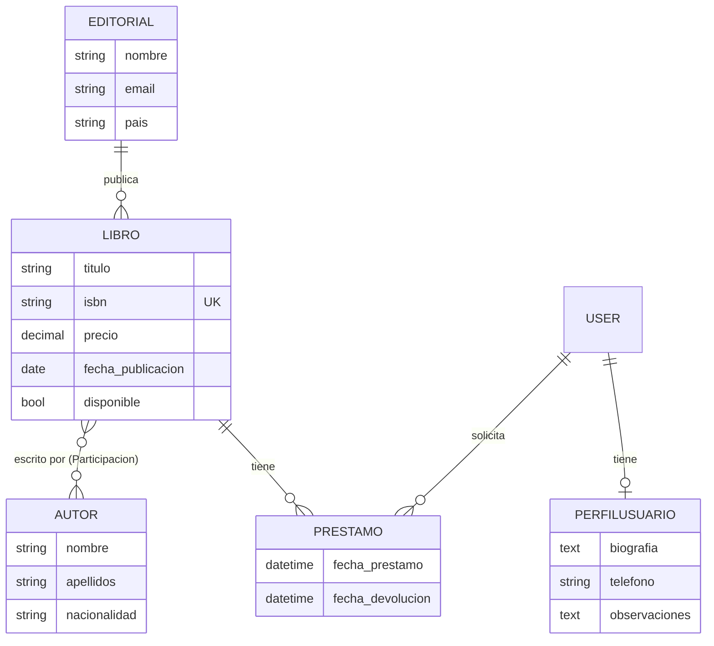

# MiBiblioteca

Práctica de Django (2º DAW, IES Hermanos Machado): proyecto `biblioteca`, app `catalogo`, con los modelos `Libro`, `Editorial`, `Autor`, `PerfilUsuario`, `Participacion` y `Prestamo`. Base de datos SQLite por defecto.

## 1. Instalación, migraciones y ejecución

```bash
git clone <url-del-repositorio>
cd MiBiblioteca
python -m venv .venv
source .venv/bin/activate        # Windows: .venv\Scripts\activate
pip install -r requirements.txt

python manage.py migrate
python manage.py createsuperuser
python manage.py runserver
```

- Web: <http://127.0.0.1:8000/>
- Administración: <http://127.0.0.1:8000/admin/>
- Datos de ejemplo (opcional): `python manage.py shell < cargar_libros.py` (con `REINICIAR = True` borra y vuelve a crear los datos de ejemplo).
- Tests: `python manage.py test catalogo`

## 2. Modelo de datos



Reglas de integridad:

| Regla                                                                 | Dónde se garantiza                                                                     |
| --------------------------------------------------------------------- | -------------------------------------------------------------------------------------- |
| El ISBN es único                                                      | `unique=True` en `Libro.isbn`                                                          |
| El precio no es negativo                                              | `CheckConstraint` `libro_precio_no_negativo`                                           |
| Un libro no puede tener más de un préstamo activo                     | `UniqueConstraint` parcial `un_prestamo_activo_por_libro` (`fecha_devolucion IS NULL`) |
| No se borra un libro, un usuario ni una editorial con datos asociados | `on_delete=PROTECT`                                                                    |
| Prestar y devolver es todo o nada                                     | `transaction.atomic()` en `prestar_libro` y `devolver_libro`                           |

## 3. Migraciones

```bash
python manage.py makemigrations
python manage.py migrate
python manage.py showmigrations catalogo
```

| Migración                                   | Contenido                                                               |
| ------------------------------------------- | ----------------------------------------------------------------------- |
| `0001`–`0010`                               | Modelos iniciales, editorial, M2M con autores, perfil y `Participacion` |
| `0011_prestamo_y_restriccion_precio`        | Modelo `Prestamo` y restricción de precio no negativo                   |
| `0012_perfilusuario_telefono_observaciones` | Campos nuevos de `PerfilUsuario`                                        |
| `0013_un_prestamo_activo_por_libro`         | Un solo préstamo activo por libro                                       |

## 4. CRUD (funciones de `catalogo/views.py`)

Se ejecutan desde `python manage.py shell`.

```python
from catalogo.views import (
    crear_editorial_y_autores, crear_tres_libros, libro_por_isbn,
    modificar_precio, eliminar_libro,
)

editorial, autor_uno, autor_dos = crear_editorial_y_autores()
libros = crear_tres_libros(editorial, autor_uno, autor_dos)
libro_por_isbn("9780000001001")
modificar_precio("9780000001001", "15.00")
eliminar_libro("9780000001003")
```

Resultado:

```text
--- 1. Editorial y dos autores
Editorial Demo | Ana Demo Uno | Luis Demo Dos
--- 2. Tres libros con sus autores
9780000001001 Libro Demo 1 ['Ana Demo Uno']
9780000001002 Libro Demo 2 ['Luis Demo Dos', 'Ana Demo Uno']
9780000001003 Libro Demo 3 ['Luis Demo Dos']
--- 3. Recuperar por ISBN
Libro Demo 1 | precio: 12.50
--- 4. Modificar el precio
Libro Demo 1 | precio: 15.00
--- 5. Eliminar un libro sin préstamos
(2, {'catalogo.Libro_autores': 1, 'catalogo.Libro': 1})
```

`eliminar_libro` lanza `ValueError` si el libro tiene préstamos.

## 5. Consultas ORM

```python
from catalogo.views import (
    libros_disponibles, buscar_libros, libros_de_editorial, libros_de_autor,
    precio_medio, libros_por_editorial, prestamos_activos,
)
```

| #   | Consulta                                | ORM                                                        |
| --- | --------------------------------------- | ---------------------------------------------------------- |
| 1   | Libros disponibles ordenados por título | `Libro.objects.filter(disponible=True).order_by("titulo")` |
| 2   | Buscar por texto en el título           | `Libro.objects.filter(titulo__icontains=texto)`            |
| 3   | Libros de una editorial                 | `Libro.objects.filter(editorial_id=editorial_id)`          |
| 4   | Libros de un autor                      | `Libro.objects.filter(autores__id=autor_id)`               |
| 5   | Precio medio                            | `Libro.objects.aggregate(precio_medio=Avg("precio"))`      |
| 6   | Número de libros por editorial          | `Editorial.objects.annotate(total_libros=Count("libros"))` |
| 7   | Préstamos activos                       | `Prestamo.objects.filter(fecha_devolucion__isnull=True)`   |

Resultados (con los datos de `cargar_libros.py` más los del apartado 4):

```text
--- 1. Libros disponibles ordenados por título
10 libros; los tres primeros:
   Aplicaciones web con Django y Python
   Django en la práctica
   Don Quijote de la Mancha
--- 2. Buscar por título ('django')
['Aplicaciones web con Django y Python', 'Django en la práctica']
--- 3. Libros de la editorial 'Editorial Demo'
['Libro Demo 1', 'Libro Demo 2']
--- 4. Libros de un autor (Ana Demo Uno)
['Libro Demo 1', 'Libro Demo 2']
--- 5. Precio medio
19.62
--- 6. Número de libros de cada editorial
  Editorial Demo 2
--- 7. Préstamos activos (todavía ninguno)
[]
```

## 6. Préstamos, devoluciones y rollback

Las operaciones `prestar_libro(libro_id, usuario)` y `devolver_libro(prestamo_id)` están en `catalogo/views.py` y se ejecutan dentro de `transaction.atomic()`. La web las expone en `/prestamo/<libro>/<usuario>/` y `/devolucion/<prestamo>/` mediante las vistas `prestar_libro_vista` y `devolver_libro_vista`.

```python
from catalogo.views import prestar_libro, devolver_libro, prestamos_activos
```

```text
Disponible antes: True
--- Préstamo correcto
Préstamo 1: Libro Demo 1 | disponible: False
Préstamos activos: ['Préstamo 1: Libro Demo 1']
--- Préstamo rechazado (libro no disponible)
ValueError: El libro no está disponible
--- Un solo préstamo activo por libro (restricción de la base de datos)
IntegrityError: UNIQUE constraint failed: catalogo_prestamo.libro_id
--- Devolución correcta
Devuelto | disponible: True | activos: 0
--- Doble devolución rechazada
ValueError: El préstamo ya fue devuelto
--- Rollback con transaction.atomic()
Dentro de atomic(), disponible = False
RuntimeError: Error simulado
Tras refresh_from_db(), disponible = True
--- Precio negativo (CheckConstraint)
IntegrityError: CHECK constraint failed: libro_precio_no_negativo
```

`select_for_update()` bloquea la fila en PostgreSQL (`SELECT ... FOR UPDATE`); SQLite lo ignora porque bloquea toda la base de datos al escribir.

## 7. Panel de administración

- `Libro`: columnas título, ISBN, editorial, precio y disponible; filtros por editorial, disponibilidad y género; búsqueda por título, ISBN y autor.
- `Prestamo`: columnas libro, usuario, fechas; filtro por devolución.
- Registrados también `Autor`, `Editorial` y `PerfilUsuario`.
- Los tests (`IntegradoraTests.test_panel_de_administracion`) comprueban que listados, formularios de alta, búsqueda y filtros responden con 200.

## 8. Configuración de `DATABASES`

SQLite (por defecto):

```python
DATABASES = {
    "default": {
        "ENGINE": "django.db.backends.sqlite3",
        "NAME": BASE_DIR / "db.sqlite3",
    }
}
```

PostgreSQL (sin credenciales en el código; se leen del entorno):

```python
import os

DATABASES = {
    "default": {
        "ENGINE": "django.db.backends.postgresql",
        "NAME": os.environ.get("DB_NAME", "biblioteca"),
        "USER": os.environ.get("DB_USER", ""),
        "PASSWORD": os.environ.get("DB_PASSWORD", ""),
        "HOST": os.environ.get("DB_HOST", "localhost"),
        "PORT": os.environ.get("DB_PORT", "5432"),
    }
}
```

Pasos para pasar a PostgreSQL: crear base de datos y usuario, `pip install psycopg[binary]`, definir las variables de entorno `DB_*`, sustituir `DATABASES` y ejecutar `python manage.py migrate`. La prueba contra PostgreSQL no se ha realizado.

## 9. Preguntas finales

1. **ORM frente a SQL.** El ORM permite escribir consultas en Python, es independiente del motor y evita errores de SQL; el SQL directo da más control para consultas muy complejas.
2. **Migraciones como código.** Son archivos versionados que describen los cambios del esquema, se aplican en el mismo orden en cualquier máquina y quedan en el historial de Git.
3. **FK, M2M y O2O.** `ForeignKey`: muchos a uno (libro → editorial). `ManyToManyField`: muchos a muchos (libros ↔ autores). `OneToOneField`: uno a uno (usuario ↔ perfil).
4. **Por qué el préstamo necesita transacción.** Crea el préstamo y marca el libro como no disponible: si falla uno de los dos pasos, no debe quedar el otro a medias.
5. **Pasos para PostgreSQL.** Los del apartado 8.

## 10. Estructura

```text
biblioteca/        configuración del proyecto
catalogo/          app: models.py, views.py, admin.py, tests.py, urls.py, migrations/
cargar_libros.py   datos de ejemplo
requirements.txt
```

No se versionan: `.venv/`, `db.sqlite3`, `.env`, credenciales.
